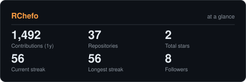
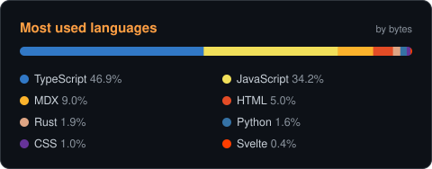

<!-- BANNER - terminal profile.sh --live. Generated by scripts/banner.py from assets/profile.json.
     Drop a photo at assets/source/photo.jpg and re-run to swap the monogram for a portrait. -->
<picture>
  <source media="(prefers-color-scheme: dark)"  srcset="assets/banner-dark.svg">
  <source media="(prefers-color-scheme: light)" srcset="assets/banner-light.svg">
  
</picture>

 

<!-- NAME / TAGLINE - animated typing -->

 

<!-- SOCIALS -->
&nbsp;&nbsp;
&nbsp;&nbsp;

 

---

## This is me :)

Hi, I'm **RChefo**, a full-stack developer broadcasting from Cairo, Egypt 🇪🇬.
I build web apps, dashboards and Discord tooling, mostly in TypeScript, and I like
taking an idea all the way from a blank repo to something people actually use.

- 🎮 Building **[Winy](https://playwiny.io)** and the community around it on **[Discord](https://discord.gg/winy)**.
- 📚 Working on **Rookn**: a web platform, a staff dashboard, and a standalone PDF studio to read, annotate and edit PDFs and convert them to Word.
- ✅ Shipping **[dooit](https://dooit.live)**.
- 🤖 Lots of Discord bots under the hood: support, modmail logs, reports, and Probot translations.
- 💬 Talk to me about **TypeScript, React / Next.js, Node**, or getting a side project out the door.

 

## my stack

---

## signals

<table>
<tr>
<td width="50%" align="center" valign="middle">

<!-- Self-rated radar - edit assets/skills.json, the workflow redraws it -->
<picture>
  <source media="(prefers-color-scheme: dark)"  srcset="assets/radar-dark.svg">
  <source media="(prefers-color-scheme: light)" srcset="assets/radar-light.svg">
  
</picture>

</td>
<td width="50%" align="center" valign="middle">

<!-- Self-rated language radar - edit assets/langmix.json -->
<picture>
  <source media="(prefers-color-scheme: dark)"  srcset="assets/radar-langs-dark.svg">
  <source media="(prefers-color-scheme: light)" srcset="assets/radar-langs-light.svg">
  
</picture>

</td>
</tr>
</table>

---

## numbers

<!-- Generated by scripts/cards.py into this repo, refreshed daily by the Charts workflow. -->
<picture>
  <source media="(prefers-color-scheme: dark)"  srcset="assets/card-stats-dark.svg">
  <source media="(prefers-color-scheme: light)" srcset="assets/card-stats-light.svg">
  
</picture>

 

<picture>
  <source media="(prefers-color-scheme: dark)"  srcset="assets/card-langs-dark.svg">
  <source media="(prefers-color-scheme: light)" srcset="assets/card-langs-light.svg">
  
</picture>

---

` built with ☕ · RChefo `

